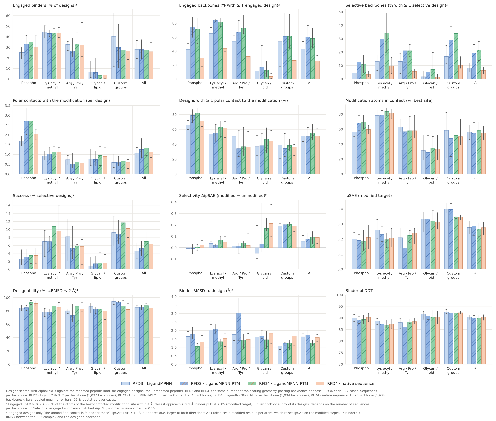

# PTM-Binder-Design



**Design protein binders against post-translationally modified targets** — phospho-Tyr/Ser/Thr, acetyl-/methyl-Lys, glycans, lipids, or any covalent group you define by
CCD code or SMILES — and rank them by whether they prefer the **modified** over the **unmodified** target.

| You give | You get |
|---|---|
| a target structure and the modification (a name, a CCD code, or SMILES + linkage) | RFdiffusion3 backbones · PTM-aware LigandMPNN sequences · AlphaFold 3 co-folds of the **modified and the unmodified** target · a ranked, seed-confirmed shortlist |

```
 spec.json ─► ptm-rfd3 design ─► ptm-rfd3 stage ─► AlphaFold 3 ─► ptm-rfd3 score ─► ptm-rfd3 select ─► ptm-rfd3 seeds ─► AF3 ─► ptm-rfd3 confirm
              RFdiffusion3        filter, PTM-aware  modified AND   token-matched      filters +          5-seed inputs         selective in
              (GPU)               LigandMPNN, AF3    unmodified     selectivity        AF3 models         for the hits          every seed
                                  inputs (CPU)       target (GPU)
```

| Design principle | |
|---|---|
| **RFdiffusion3 as released** | the modification is *conditioning*: its atoms are fixed in the target and hotspots can sit on them. RFD3 never generates the modification. |
| **Build it, or use it** | a modification already in your file is used as is; a missing one is built with RDKit in place on the fixed structure (CCD chemistry, learned conformer ranking), together with an unmodified control. |
| **Sequence design that sees the modification** | stock LigandMPNN silently drops modification atoms; the bundled **[PTM-aware LigandMPNN](#ptm-aware-ligandmpnn)** (fork + fine-tuned weights, usable on its own) keeps them and shows them to the model. |
| **A fair score** | AF3 gives every atom of a modified residue its own token, which inflates ipTM — [`ptm-rfd3 score`](#understanding-the-scores) reports a token-matched selectivity instead. |
| **One CLI** | everything — PTM definition, linkage, conditioning, filtering, scoring — is specified in one spec file and driven by `ptm-rfd3`. |

> **Status: research code, in-silico only.** Binders are judged by AF3 co-folds; nothing has been tested in the lab. See [What was done & performance](#what-was-done--performance) for what to expect.

---

## Contents
1. [Installation](#installation)
2. [Quick start](#quick-start)
3. [Specifying the target](#specifying-the-target) — [the modification](#the-modification) · [conditioning](#condition-on-it) · [more examples](#more-examples)
4. [Running the funnel](#running-the-funnel) — [steps](#the-steps) · [what comes out](#what-comes-out) · [cheaper screening](#cheaper-screening----two-stage) · [seed confirmation](#always-confirm)
5. [PTM-aware LigandMPNN](#ptm-aware-ligandmpnn) — [why a fork](#why-a-fork) · [use it standalone](#use-it-standalone) · [fine-tuned weights](#the-fine-tuned-weights) · [performance](#performance) · [in this pipeline](#in-this-pipeline)
6. [Understanding the scores](#understanding-the-scores)
7. [What was done & performance](#what-was-done--performance)
8. [Troubleshooting & FAQ](#troubleshooting--faq)
9. [Repository](#repository) · [Acknowledgements](#acknowledgements) · [License](#license)

---

## Installation

| Component | Needed for | Runs on | How |
|---|---|---|---|
| `ptm-rfd3` + PTM-aware LigandMPNN | everything except RFD3 sampling and AF3 | CPU | this repository — steps 1 and 2 |
| RFdiffusion3 | `ptm-rfd3 design` | 1 GPU | `pip install "rc-foundry[rfd3]"` — step 3 |
| AlphaFold 3 | co-folding | 1 GPU | your AF3 install and weights from Google DeepMind — step 4 |

### 1 · This repository
Python ≥ 3.10 (tested with 3.12).
```bash
git clone https://github.com/Jetzu/PTM-Binder-Design.git && cd PTM-Binder-Design
python3.12 -m venv .venv && source .venv/bin/activate
pip install -e ".[test]"        # ptm-rfd3 and its dependencies: numpy scipy pandas pyyaml rdkit biotite (+ pytest)
```

### 2 · PTM-aware LigandMPNN
CPU torch is enough (≈ 3 s per structure).
```bash
pip install torch --index-url https://download.pytorch.org/whl/cpu
pip install -r LigandMPNN_PTM/requirements_tested.txt
mkdir -p LigandMPNN_PTM/model_params
wget https://files.ipd.uw.edu/pub/ligandmpnn/ligandmpnn_v_32_010_25.pt -P LigandMPNN_PTM/model_params     # released weights (10 MB)
```
The PTM fine-tuned weights (`model_params_ptm/ligandmpnn_ptm_ft_v2A.pt`, 10.5 MB) are already in git. All upstream weights: `cd LigandMPNN_PTM && bash get_model_params.sh ./model_params`.

### 3 · RFdiffusion3
Developed against Foundry commit `e412591`.
```bash
pip install "rc-foundry[rfd3]"
foundry install rfd3 --checkpoint-dir <dir>
export RFD3_CKPT=<dir>/rfd3_latest.ckpt
```

### 4 · AlphaFold 3
AF3 is not redistributable (the weights come from Google DeepMind under their terms). The pipeline needs two things from it:

| It must… | Details |
|---|---|
| **run our inputs** | standard AF3 JSON written by `ptm-rfd3 stage`: protein chains with MSAs, `modifications`, `bondedAtomPairs`, covalent ligands (and a `userCCD` block for SMILES-defined groups) |
| **return one tar** | a folder per input holding `*_model.cif`, `*_confidences.json`, `*_summary_confidences.json` |

We use [AlphaFast](https://github.com/RomeroLab/alphafast) in Apptainer: `export AF3_SIF=<image.sif> AF3_WEIGHTS=<parameter dir>`; `scripts/slurm/af3_batch.sbatch` drives it.

### Check the installation
No GPU needed.
```bash
ptm-rfd3 prepare examples/specs/egfr_pY1138.json --out WORK     # builds phospho-Tyr1138 with RDKit and writes the RFD3 specs (≈ 25 s)
```

<details>
<summary><b>Environment variables</b> — nothing is hard-coded to a site</summary>

| Variable | Meaning [default] |
|---|---|
| `RFD3_CKPT` / `CKPT` | RFD3 checkpoint for `scripts/slurm/rfd3_design.sbatch` (`CKPT` wins) |
| `RFD3_PYTHON` [`python3`] | python with `rc-foundry` and this package |
| `RFD3_ENV_TAR` + `RFD3_ENV_PYREL` | alternative: a relocatable env tar, unpacked on the node; python path inside it [`rfd3_ssadj_test/bin/python`] |
| `FOUNDRY`, `ATOMWORKS` | optional Foundry / AtomWorks source trees put on `PYTHONPATH` |
| `SPECS`, `OUTSUB`, `TAG`, `NB`, `DBS`, `SEED`, `KEYS`, `STEP_SCALE`, `GAMMA0`, `EXTRA` | per-run settings of `rfd3_design.sbatch`: spec file, output folder, tar name, n_batches, diffusion batch size, seed, `json_keys_subset`, sampler [1.5 / 0.6], extra hydra overrides. `SPECS`, `CKPT`, `FOUNDRY` may be relative to the submission directory |
| `PTM_RFD3_WORK` [`~/ptm_rfd3_work`] | SLURM work directory; `rfd3_design.sbatch` writes `out/<OUTSUB>/<TAG>.tar` |
| `PTM_RFD3_REPO` [submit dir] | repository path for the SLURM scripts |
| `AF3_SIF`, `AF3_WEIGHTS` | AF3 image and parameters (`af3_batch.sbatch`) |
| `IN_TAR` or `IN_DIR`, `TAR`, `SAMPLES` [5], `RECYCLES` [10], `BUDGET_MIN` [95] | AF3 input, output tar, samples per input, recycles, time budget |
| `PTM_RFD3_LIGANDMPNN` [`<repo>/LigandMPNN_PTM`] | directory with LigandMPNN's `run.py` |
| `PTM_RFD3_MPNN_PYTHON` [current python] · `PTM_RFD3_MPNN_PYTHONPATH` | interpreter for LigandMPNN · extra `PYTHONPATH` (prepended) |
| `PTM_RFD3_MSA_CACHE` [`~/.cache/ptm_rfd3/msa`] | ColabFold MSA cache (structured targets, API only) |
| `CCD_COMPONENTS_CIF` | wwPDB `components.cif` for extending the shipped CCD subset |

The `#SBATCH` lines in `scripts/slurm/*.sbatch` are our cluster's (partition `preempt`, 1 GPU, `--requeue`). Override them — `sbatch -p <partition> -t <time> --gres=gpu:1 …` — and submit from the repository root.
</details>

---

## Quick start

The whole funnel for the bundled example (EGFR C-terminal tail with phospho-Tyr1138):

```bash
# 1 — dry run: build the modification once and write plain RFD3 specs (CPU, ≈ 25 s)
ptm-rfd3 prepare examples/specs/egfr_pY1138.json --out WORK

# 2 — backbones with RFdiffusion3 (GPU)
ptm-rfd3 design ckpt_path=$RFD3_CKPT inputs=examples/specs/egfr_pY1138.json out_dir=OUT n_batches=15 diffusion_batch_size=8

# 3 — geometry filter → PTM-aware LigandMPNN → AF3 inputs for modified and unmodified target (CPU)
ptm-rfd3 stage OUT --out STAGE --top 6 --n-seq 2

# 4 — AlphaFold 3 on both arms (GPU)
IN_TAR=STAGE/af3_inputs.tar TAR=STAGE/af3_out.tar sbatch scripts/slurm/af3_batch.sbatch

# 5 — token-matched selectivity per binder, then the shortlist
ptm-rfd3 score  --tar STAGE/af3_out.tar --index STAGE/af3_index.json --out scores.csv
ptm-rfd3 select --scores scores.csv --tar STAGE/af3_out.tar --out finalists
```
Then confirm the hits with five AF3 seeds — [see below](#always-confirm). On a SLURM cluster, step 2 is
`SPECS=examples/specs/egfr_pY1138.json OUTSUB=run TAG=r1 NB=15 DBS=8 sbatch scripts/slurm/rfd3_design.sbatch`.

---

## Specifying the target

A spec is an ordinary **RFD3 input file** (JSON or YAML, name → spec) with a few extra keys. **Every RFD3 key still works** — `contig`, `select_buried`, `select_hbond_acceptor`,
`partial_t`, `is_non_loopy`, … — the extra keys are consumed first and never reach RFD3. `examples/specs/egfr_pY1138.json`:

```json
{ "egfr_pY1138": { "input": "../egfr_tail_1126_1150.pdb",
                   "ptm": {"A1138": "phospho-Tyr"},
                   "ptm_hotspots": ["patch"],
                   "ptm_conformers": 3,
                   "contig": "70-110,/0,A1126-1150",
                   "is_non_loopy": true } }
```

| Rule | |
|---|---|
| **Residue numbers** | refer to *your* file (`A1126-1150`, `A1138`). Internally long keys may be compacted; the pipeline translates your selections, `report.json` stores the offset. |
| **`input`** | looked up relative to the working directory, then to the spec file. |
| **Chains / residues** | RFD3 needs single-letter chain ids and no insertion codes on polymer residues (the prep step renumbers or refuses and says why). |
| **Target size** | AF3 later folds the *whole* prepared target — trim `input` to the region you need. |

### The modification

`"ptm": {"<chain+residue>": <what>, …}` — several modifications at once are fine.

| `<what>` | Example | Meaning |
|---|---|---|
| **Registry name** | `"A1138": "phospho-Tyr"` | residue replacement or ligand with the right chemistry and covalent link (list below) |
| **CCD code** of a modified amino acid | `"A9": "KCR"` | replaces the residue; the parent atoms stay in place |
| **CCD ligand + linkage** | `"A120": {"adduct": "NAG", "anchor": "ND2", "ligand_atom": "C1", "leaving": ["O1"]}` | any ligand of the shipped CCD subset, bonded residue atom `anchor` — ligand atom `ligand_atom`. String form: `"adduct:NAG@ND2:C1-O1"` |
| **SMILES + linkage** | `"A9": {"smiles": "*C(=O)CCCC[C@@H]1SC[C@@H]2NC(=O)N[C@H]12", "anchor": "NZ"}` | a custom group: `*` marks the attachment point and is bonded to residue atom `anchor`. Optional 3-character `name` (default: a code that is **not** a wwPDB component). Atoms are named `C1, C2, … N1, O1, …` in SMILES order. |
| `"keep"` | `"ptm": "keep"` | the input already carries the modification — only normalise it (covalent bonds are read from `struct_conn`) |

<details open>
<summary><b>Registry names</b></summary>

| Class | Names |
|---|---|
| Phosphorylation | `phospho-Ser` `phospho-Thr` `phospho-Tyr` `phospho-His-N1` `phospho-His-N3` `phospho-Asp` |
| Lysine | `acetyl-Lys` `crotonyl-Lys` `methyl-Lys` `dimethyl-Lys` `trimethyl-Lys` `carboxy-Lys` `hydroxy-Lys` `biotinyl-Lys` `lipoyl-Lys` |
| Arginine / proline | `citrulline` `dimethyl-Arg-asym` `dimethyl-Arg-sym` `hydroxy-Pro` |
| Others | `sulfo-Tyr` `nitro-Tyr` `sulfenic-Cys` `S-nitroso-Cys` `S-palmitoyl-Cys` `S-farnesyl-Cys` `N-myristoyl-Gly` `pyroglutamate` |
| Glycans | `N-GlcNAc` `O-GlcNAc-Ser` `O-GlcNAc-Thr` `O-GalNAc-Ser` `O-GalNAc-Thr` `O-Fuc-Ser` `O-Fuc-Thr` (glycan trees already present in a structure are kept intact) |

Names are case- and separator-insensitive (`phospho_ser` = `Phospho-Ser`).
</details>

**Good to know**

| | |
|---|---|
| **Extra links** | a link your file lacks: `"covalent_bonds": ["A45:ND2-Z1:C1"]` (`CHAIN+RESID:ATOM-CHAIN+RESID:ATOM`). |
| **Ligand chains** | covalently attached ligands and glycans move to their own chains `Z`, `Y`, … — one residue each, RFD3's convention. The mapping is printed and stored in `report.json`. |
| **More CCD components** | the shipped subset has 1,143 components; extend it with the wwPDB `components.cif` via `ptm_rfd3/data/build_ccd_subset.py` (`CCD_COMPONENTS_CIF`). |
| **SMILES groups** | their definition is stored in the build manifest and reaches AF3 as a `userCCD` block (run end to end through RFD3 → LigandMPNN → AF3 → `score` with a test group). The residue code must not be a real wwPDB component (RFD3 and AF3 would substitute the real one) — an explicit `name` that collides is refused, the default is always free. |
| **Modification in a newly generated chain** | RFD3 cannot place a modified residue by itself; `"ptm_motifs": [{"mod": "N-GlcNAc", "seq": "LNT", "pos": 2}]` plus `{motif}` in the contig builds a 3-residue peptide with the modification and uses it as a fixed motif — [`examples/specs/generated_chain_motif.json`](examples/specs/generated_chain_motif.json). |

### Condition on it

| Key | Effect |
|---|---|
| `"ptm_hotspots": ["ptm"]` | RFD3 `select_hotspots` on the **modification atoms only** |
| `"ptm_site"` | + the side chain of the modified residue |
| `"patch"` · `"patchN"` | `ptm_site` + the *N* (default 3) nearest surface residues |
| suffix `_hb` — e.g. `"patch_hb"` | also condition H-bond acceptors of the modification |
| a list, e.g. `["ptm", "patch"]` | one spec per mode (names `<name>_ptm_k0_<mode>`) |
| `"select_hotspots": {…}` | your own entries win. PTM atoms carry their CCD names (phospho-Tyr: `OH P O1P O2P O3P`), SMILES groups `C1, C2, …`, ligand chains are `Z, Y, …` — e.g. `{"Z1": "C1,C2"}` |
| `"ptm_conformers": N` | design against the top-*N* RDKit conformers of the modification (one spec each, `_ptm_k0 … _ptm_k{N-1}`) |
| `"ptm_n_confs"` [300] · `"ptm_seed"` [0] | size and seed of the conformer search |

### More examples

Syntax examples (adapt `input`, residues and `contig` to your target):

```json
{ "acetyl_lysine":   { "input": "target.pdb", "ptm": {"A45": "acetyl-Lys"},
                       "ptm_hotspots": ["ptm_site"], "contig": "60-100,/0,A30-70" },

  "two_sites":       { "input": "target.pdb", "ptm": {"A45": "phospho-Ser", "A60": "phospho-Thr"},
                       "ptm_hotspots": ["patch"], "ptm_conformers": 2, "contig": "70-110,/0,A30-80" },

  "glycan":          { "input": "target.pdb", "ptm": {"A120": "N-GlcNAc"},
                       "ptm_hotspots": ["ptm"], "contig": "60-100,/0,A100-140" },

  "already_modified":{ "input": "target_with_ptm.cif", "ptm": "keep",
                       "ptm_hotspots": ["patch"], "contig": "70-110,/0,A30-80" },

  "smiles_group":    { "input": "target.pdb",
                       "ptm": {"A45": {"smiles": "*C(=O)CCCC[C@@H]1SC[C@@H]2NC(=O)N[C@H]12", "anchor": "NZ"}},
                       "ptm_hotspots": ["ptm"], "contig": "60-100,/0,A30-70" } }
```
Runnable examples: [`examples/specs/egfr_pY1138.json`](examples/specs/egfr_pY1138.json) (registry name), [`custom_group_smiles.json`](examples/specs/custom_group_smiles.json) (SMILES group),
[`generated_chain_motif.json`](examples/specs/generated_chain_motif.json) (modification inside a generated chain).

---

## Running the funnel

### The steps

| Step | Command | Where |
|---|---|---|
| **1 · Dry run** (optional) | `ptm-rfd3 prepare spec.json --out WORK` | CPU |
| **2 · Design** | `ptm-rfd3 design ckpt_path=$RFD3_CKPT inputs=spec.json out_dir=OUT n_batches=15 diffusion_batch_size=8` — the usual RFD3 hydra arguments, PTM keys handled first. SLURM: `SPECS=spec.json OUTSUB=run TAG=r1 NB=15 DBS=8 sbatch scripts/slurm/rfd3_design.sbatch` | GPU |
| **3 · Stage** | `ptm-rfd3 stage OUT --out STAGE --top 6 --n-seq 2` (`OUT` = design folder or SLURM tar) | CPU |
| **4 · AF3** | `IN_TAR=STAGE/af3_inputs.tar TAR=STAGE/af3_out.tar sbatch scripts/slurm/af3_batch.sbatch` | GPU |
| **5 · Score** | `ptm-rfd3 score --tar STAGE/af3_out.tar --index STAGE/af3_index.json --out scores.csv` | CPU |
| **6 · Select** | `ptm-rfd3 select --scores scores.csv --tar STAGE/af3_out.tar --out finalists --min-delta 0.15` | CPU |
| **7 · Confirm** | see [Always confirm](#always-confirm) | CPU + GPU |

**What `stage` does.** A backbone continues only if there is no clash, the binder's closest approach to the modification atoms is 2.4–6 Å, at least one target residue is within 4.5 Å,
and — for modifications with polar atoms — at least two H-bonds (for phosphate/sulfate also an Arg/Lys). For the best `--top` backbones per (spec, conformer) it designs `--n-seq` sequences with
PTM-aware LigandMPNN and writes **two AF3 inputs per sequence: the modified target and the unmodified control**.

| `stage` option | |
|---|---|
| `--mpnn-model released` (default) · `ptm-ft` · `<path>` | upstream LigandMPNN weights with PTM-aware parsing · the PTM fine-tuned weights shipped in `LigandMPNN_PTM/` · your own checkpoint |
| `--ala-bias 1.0` | penalty on Ala (PTM-aware MPNN drifts to Ala-rich sequences) |
| `--temperature 0.1` · `--seed` · `--workers` | sampling temperature · seed · parallel LigandMPNN processes (CPU, one per structure) |
| `--two-stage` | write the modified arm only, see [cheaper screening](#cheaper-screening----two-stage) |
| `--geometry-only` | stop after the geometry filter and print the pass rate per run and spec |

### What comes out

| Step | Files |
|---|---|
| `prepare` | `WORK/<name>_<hash>/ptm_k0.cif … ptm_k{N-1}.cif` (RDKit conformers, k0 = best ranked) · `unmod.cif` (unmodified control) · `report.json` (what was built, ligand chains, offsets) · `manifest.json` · `WORK/specs_expanded.json` |
| `design` | RFD3 designs (`*.cif.gz` + json) and `OUT/ptm_build/` with the same built targets |
| `stage` | `STAGE/geometry_metrics.csv` (per backbone) · `mpnn_p/` (sequences) · **`af3_inputs.tar`** · **`af3_index.json`** · `manifests.json` |
| `score` | **`scores.csv`** (one row per binder, both arms paired) · `scores_raw.csv` (one row per prediction) |
| `select` | `finalists/selected.csv` + the AF3 model of every selected binder |
| `seeds` · `confirm` | `SEEDS_inputs.tar`, `SEEDS_index.json` · `confirmed.csv` |

### Cheaper screening — `--two-stage`
Most binders fail the engagement filters in the modified arm, so the control arm is only worth computing for the rest (≈ ⅓ less AF3 time):
```bash
ptm-rfd3 stage OUT --out STAGE --two-stage                          # modified arm only
IN_TAR=STAGE/af3_inputs.tar TAR=STAGE/af3_out.tar sbatch scripts/slurm/af3_batch.sbatch
ptm-rfd3 score --tar STAGE/af3_out.tar --index STAGE/af3_index.json --out scores.csv      # writes scores_raw.csv; no pairs yet
ptm-rfd3 control --scores scores_raw.csv --index STAGE/af3_index.json --manifests STAGE/manifests.json --out STAGE
IN_TAR=STAGE/af3_inputs_ctl.tar TAR=STAGE/af3_out_ctl.tar sbatch scripts/slurm/af3_batch.sbatch
ptm-rfd3 score --tar STAGE/af3_out.tar STAGE/af3_out_ctl.tar --index STAGE/af3_index.json STAGE/af3_index_ctl.json --out scores.csv
```

### Always confirm
A binder that passes in a single AF3 seed is often a lucky draw (winner's curse). Re-fold the hits with five seeds:
```bash
ptm-rfd3 seeds --scores scores.csv --index STAGE/af3_index.json --af3-inputs STAGE/af3_inputs.tar --out SEEDS --n-seeds 5 --min-delta 0.15
IN_TAR=SEEDS_inputs.tar TAR=SEEDS_out.tar sbatch scripts/slurm/af3_batch.sbatch
ptm-rfd3 score   --tar SEEDS_out.tar --index SEEDS_index.json --out seed_scores.csv
ptm-rfd3 confirm --scores seed_scores.csv --out confirmed.csv --n-seeds 5 --min-worst 0.05
```
(For a two-stage screen pass both index files and both input tars to `seeds`.)

| `confirmed.csv` column | Meaning |
|---|---|
| `n_seeds`, `d_tm_mean`, `d_tm_sd`, `d_tm_worst` | distinct valid seeds and the spread of the token-matched delta |
| `selective_all` / **`confirmed`** | five distinct finite seeds and the worst seed's `d_tm` > `--min-worst` |
| `engaged_all` | the engagement filters hold in every seed; `confirm --require-engagement` makes it part of `confirmed` (much stricter) |
| `n_invalid`, `inconsistent` | rows without a usable seed/delta, or duplicate rows of one seed that disagree — either blocks confirmation |

---

## PTM-aware LigandMPNN

The sequence stage is a **fork of LigandMPNN that understands modified residues and covalently attached ligands**, plus a **PTM fine-tuned checkpoint**. It lives in
[`LigandMPNN_PTM/`](LigandMPNN_PTM/) (own [README](LigandMPNN_PTM/README.md), 25 tests, full fine-tuning pipeline) and works **on its own** for any PTM or covalent-ligand design task — you do not need RFD3 or AF3 to use it.

### Why a fork
Stock LigandMPNN only knows the 20 amino acids. A modified residue becomes token `X` and its modification atoms (the phosphate!) are silently dropped, or the residue is turned into ligand atoms and removed from the chain —
on 140 real PTM structures stock LigandMPNN dropped residues from the chain in 53 and produced `X` tokens in 93. For binder design that is the worst case: the modification is exactly what the binder must recognise.

| What the fork does | |
|---|---|
| **Recognise** | 1,125 CCD components (every L-peptide-linking component with a standard parent — SEP→Ser, TPO→Thr, PTR→Tyr, MSE→Met, HYP→Pro, MLY/M3L/ALY→Lys, CSO→Cys, …) join the sequence as their **parent type**, so chain continuity and neighbours are right |
| **Auto-detect** | unknown peptide-bonded residues are kept (token `X`) instead of being dropped |
| **Find covalent links** | a ligand atom within covalent radii of a side-chain atom marks the residue as modified (glycans, covalent inhibitors); optional protein–protein cross-links (ubiquitin/SUMO isopeptide, lanthionine) |
| **Freeze** | modified and covalently linked residues are fixed — a modification only exists on its residue type (`--redesigned_residues` overrides) |
| **Show** | the modification atoms are added to the ligand context the neighbouring residues see (`--ptm_context_atoms`) |
| **Write faithfully** | fixed residues are written verbatim (name, atoms, coordinates) to `packed/*.pdb` |

Inputs without any modification behave exactly like upstream with the released weights (bit-identical, tested).

### Use it standalone
```bash
cd LigandMPNN_PTM
python run.py --model_type ligand_mpnn --pdb_path examples/1SHA.cif --chains_to_design A \
    --checkpoint_ligand_mpnn model_params_ptm/ligandmpnn_ptm_ft_v2A.pt \
    --batch_size 8 --number_of_batches 4 --temperature 0.1 --out_folder outputs/binder
```
`examples/1SHA.cif` is an SH2 domain (chain A) bound to a phospho-tyrosine peptide (chain B, `PTR`): the log reports `PTR -> parent TYR, 4 modification atoms, fixed` and chain A is redesigned around the
phosphopeptide (≈ 10 s on a CPU node). Input can be PDB or mmCIF (`.pdb`, `.cif`, `.cif.gz`); add `--pack_side_chains 1` for side-chain packing.

| Flag | Default | Meaning |
|---|---|---|
| `--ptm_aware` | `1` | parse modified residues as parents, keep their atoms, find covalent links; `0` = exact upstream behaviour |
| `--ptm_context_atoms` | `sidechain` | what the model sees of a fixed modification: `sidechain` (whole side chain), `extras` (only atoms the parent lacks: phosphate, methyl/acetyl, …), `none` |
| `--checkpoint_ligand_mpnn` | released | `model_params/ligandmpnn_v_32_010_25.pt` (upstream) or `model_params_ptm/ligandmpnn_ptm_ft_v2A.pt` (fine-tuned) |
| `--chains_to_design` · `--redesigned_residues` · `--fixed_residues` | — | design one chain around a fixed modified target · design only / keep these residues (modified residues stay fixed unless listed) |
| `--detect_crosslinks` · `--fix_ptm_residues` · `--fix_covalent_residues` | `1` | protein–protein cross-link detection · freeze modified residues · freeze residues with a bound ligand |

Use `--model_type ligand_mpnn` (the only model that uses atom context). All other upstream flags work; the [fork README](LigandMPNN_PTM/README.md) has a cookbook.

### The fine-tuned weights
`model_params_ptm/ligandmpnn_ptm_ft_v2A.pt` (10.5 MB, in git) is LigandMPNN `v_32_010_25` fine-tuned on modification contexts. It expects the fork's PTM-aware parsing (the default).

| | |
|---|---|
| **Training data** | PDB entries released up to Dec 2021: 12,171 with a modified residue (514 with phospho-residues), 4,775 with covalent glycans, plus 18,703 ordinary entries from LigandMPNN's own list as replay; 256-residue crops centred on a PTM, glycan or ligand contact |
| **Recipe** | weights-only fine-tune with EMA, best checkpoint by validation, cluster-balanced sampling, lr 5e-5, 8 k steps; modified residues fixed, the rest designed (mixed design-everything / design-neighbourhood / design-one-chain) |
| **Evaluation** | held-out structures released **in 2023 or later** (never in the PDB snapshot the released model could have seen), homologues of the training data removed, paired bootstrap CIs; replicated over 3 training seeds |

### Performance
Native-sequence recovery of the designed residues within 8 Å of a modification (a proxy — see the caveats below).

| Subset | PTM-aware parsing alone vs stock¹ | **Fine-tuned vs stock**² |
|---|---|---|
| all biological PTMs | +1.4 pts | **+2.3** [+1.6, +3.0] |
| phospho-residues | +5.1 | **+6.7** [+4.9, +8.7] |
| phospho, binder-style (partner chain designed, 33 structures) | +6.3 | **+9.6** [+5.5, +13.5] |
| lysine modifications | +1.4 | +2.2 [+1.1, +3.3] |
| oxidised / modified Cys | +1.6 | +1.5 [+0.5, +2.5] |
| selenomethionine (MSE) | +2.6 | +3.4 [+2.9, +3.9] |
| hydroxyproline | −1.0 | +0.5 [−0.8, +2.0] (n.s.) |
| residues > 16 Å from any modification (control) | ±0.0 | no PTM-specific change |

¹ released weights, 798 held-out structures · ² shipped checkpoint, full 800-structure test set (285 biological-PTM entries, 80 with phospho-residues).

| Other checks | Result |
|---|---|
| **No regression** on ordinary design | LigandMPNN's own test sets (425 structures): +0.4 pts recovery; designability (ESMFold self-consistency) of 148 non-PTM chains 0.851 vs 0.833 stock (n.s.); EGFR-binder backbones 0.986 vs 0.986 |
| **Phosphate pockets** of 16 natural phospho-peptide complexes | native pocket residues recovered 0.66 vs 0.50 (stock); basic residues at the pocket 22 % vs 11 % (nature: 24.5 %) |
| **Phosphate engagement** of the designed binder (36 EGFR backbones × 8 sequences, AF3) | **80 %** vs 46 % (stock); PTM-aware released weights 77 % |
| **Phospho-*specific* binding** (AF3, token-matched Δ) | no measurable change: specificity Δ +0.002 [−0.035, +0.045]; contrastive decoding and interface-biased sampling did not help |
| **Where the gain comes from** | the PTM data: a replay-only control trained with the same recipe gains +0.08 pts near modifications vs +0.90 for the shipped model |

**Read this before relying on it.** The gain is local to the modification; native recovery is a proxy and close to its ceiling (free-running 0.653 vs 0.684 for an oracle that sees the true preceding residues);
the released weights already use the modification atoms (stripping them costs 2.6 pts near the site, 4.9 for phospho) and the fine-tune improves recovery *given* those atoms rather than using them more; lysine
and Cys modifications gain nothing beyond PTM-aware context; and **sequence design alone does not make a binder phospho-specific** — it makes it engage the phosphate far more often, which is why the AF3 selectivity
screen in this pipeline matters. Nothing is lab-validated.

### In this pipeline
`ptm-rfd3 stage` calls the fork on CPU, one process per backbone, with `--mpnn-model`:

| `--mpnn-model` | Weights | Context atoms | Use |
|---|---|---|---|
| `released` (default) | upstream LigandMPNN | `extras` | the configuration behind the EGFR campaign numbers in this README |
| `ptm-ft` | PTM fine-tuned | `sidechain` (what it was trained with) | the fork's recommendation for PTM targets; raises phosphate engagement, same specificity in our test |
| `<path>` | your checkpoint | `sidechain` | e.g. your own fine-tune |

Typical settings: 8–32 sequences per backbone (`--n-seq`), `--temperature 0.1`, `--ala-bias 1.0` (PTM-aware models drift to Ala-rich sequences). The EGFR funnel numbers in this README were not re-run with `ptm-ft`.

---

## Understanding the scores

AF3 tokenises a modified residue **per atom** (phospho-Tyr = 16 tokens, Tyr = 1). ipTM of the modified complex therefore weights the modification 16-fold and is normalised by another length than the
unmodified control, so **ΔipTM looks like selectivity even where there is none**. `ptm-rfd3 score` reports the **token-matched** score instead: one weight per residue and the same normalisation in both arms.

| Column of `scores.csv` | Meaning |
|---|---|
| **`d_tm`** | token-matched confidence of the modified complex minus that of the same binder on the unmodified target — **select on this** |
| `tm_res`, `tm_res_ctl` | the two token-matched confidences |
| `iptm`, `iptm_ctl`, `d_iptm` | AF3's own ipTM per arm and the difference — kept for comparison only |
| `plddt_binder` | binder pLDDT in the modified complex |
| `ptm_frac_contacted` | share of the modification's atoms within 4 Å of the binder |
| `ptm_min_dist` | closest approach of the binder to the modification (Å) |

`select` keeps binders with ipTM ≥ 0.5, ≥ 80 % of the modification atoms contacted, closest approach ≥ 2.2 Å, binder pLDDT ≥ 85 and `d_tm` ≥ `--min-delta`.
Look at the **whole distribution** of `d_tm` (`score` prints its median with a bootstrap CI), not only at the best binders: a binder that merely binds the target well scores near zero.

---

## What was done & performance

**Scope.** A complete RFD3 → LigandMPNN → AF3 funnel for modified targets, developed and benchmarked on the **EGFR C-terminal tail with phospho-Tyr1138** (25 residues) and exercised on two structured
domains (9bjc pThr161, 7w7y pTyr165). The code went through independent review rounds (every finding reproduced before it was fixed). Everything is **in-silico**:
binders are judged by AF3 co-folds, nothing has been tested in the lab.

| Stage | What was measured | Result |
|---|---|---|
| **PTM builder** | native recovery of crystal PTMs, 160 post-2022 PTMs of 14 types (the ranker was trained on earlier entries) | median **0.47–0.50 Å** heavy-atom RMSD of the new atoms (0.35 Å best of 5 conformers). AF3 predicting the target *with* the modification: 1.6 Å; building on an AF3 apo model: 2.5 Å |
| **RFD3 conditioning** | backbones that engage the phosphate (geometry filter, 600 backbones per arm) | **15–16 %** with the PTM atoms as hotspots vs **0.7 %** without. RFD3's own soft sampler defaults (step 1.5 / γ₀ 0.6) beat the documented 3 / 0.2 (15 % vs 10 %) |
| **Bond patch** | stock RFD3 drops the covalent bonds of modified residues and ligands | restored at run time; no measurable effect for a fixed peptide target, needed for glycans and other ligands |
| **PTM-aware LigandMPNN** ([details](#performance)) | native recovery within 8 Å of a modification, held-out structures from 2023 on | +1.4 pts (biological PTMs) / +5.1 pts (phospho) from PTM-aware parsing alone; **+2.3 / +6.7 pts** with the fine-tuned weights vs stock (+9.6 for phospho in the binder setting); no regression on ordinary design |
| **Funnel yield** (EGFR pTyr1138) | binders with positive token-matched selectivity in five AF3 seeds | **27 binders** with Δ > +0.05 in all 5 seeds (21 backbones, 25 sequences) — about **1 per 200 backbones**; 4 of the 27 also keep the phosphate engaged in every seed |
| **Scoring fix** | single-seed "hits" that survive | of 8 apparent hits only 3 survive the token-matched score together with seed confirmation |

**Cost.** RFD3 ≈ 0.1–0.2 GPU-h per 100 backbones (H100) · AF3 ≈ 21 s per prediction plus ≈ 75 s per new token bucket · LigandMPNN ≈ 3 s per structure on CPU · `--two-stage` saves ≈ ⅓ of the AF3 time.

**What to expect.**
* **Selectivity is the hard part.** Most designs sit on the phosphate but also bind the unmodified peptide (median token-matched Δ between −0.14 and −0.22 in our rounds).
* **Hotspots on the modification atoms are what makes RFD3 build around it** (15 % vs 0.7 % of backbones). Sampler settings, H-bond conditioning, scaffolding motifs, shorter targets and partial diffusion did not raise the yield of selective binders.
* **Sequence design helps engagement, not specificity:** PTM-aware sequences make binders touch the phosphate far more often (46 → 80 %), but no sequence-design variant made binders phospho-*specific* on its own.
* Plan for an AF3 screen of a few hundred backbones per target and **always run the five-seed confirmation**.

**Limitations.** AF3 ipTM is a proxy for binding and was not calibrated here; designs are mostly helical bundles with many charged residues, which AF3 may over-score; the control arm differs from the modified arm by the
modification's atoms, so "selective" means *AF3 is more confident with the modification present*; the builder places the modification on a rigid target and does not predict conformational change; the CLI path uses
single-sequence MSAs (fine for peptide/loop targets; structured domains need `ptm_rfd3/domain_eval.py` with ColabFold MSAs, API only); validated against Foundry `e412591`.

---

## Troubleshooting & FAQ

| Symptom | Cause / fix |
|---|---|
| `LigandMPNN not found at …` / `LigandMPNN checkpoint not found` | `LigandMPNN_PTM/` missing or the released weights were not downloaded ([step 2](#2--ptm-aware-ligandmpnn)); or set `PTM_RFD3_LIGANDMPNN` |
| LigandMPNN fails to import something | `pip install -r LigandMPNN_PTM/requirements_tested.txt`, or point `PTM_RFD3_MPNN_PYTHON` at an interpreter that has it |
| `no design passes the geometry filter` | nothing engages the modification — see `STAGE/geometry_metrics.csv`; design more backbones, add `ptm_hotspots`, try another mode |
| `no AF3 inputs were written` | designs passed but their spec has no built-modification manifest (a spec without PTM keys) — see `skipped_specs` in the output |
| `ptm-rfd3 score` warns about indexed predictions without AF3 output | the AF3 job is incomplete — rerun it, it resumes |
| `AF3 input name collision` | the same design name with another sequence was written into this `STAGE/af3_in` before; use a fresh `--out` |
| SLURM job exits non-zero after RFD3 | by design: the exit status is *designs are in the tar*; on a packing failure the designs are kept in `out/<OUTSUB>/failed_<TAG>` |
| `residue code 'XYZ' is already a wwPDB CCD component` | a SMILES group needs a code that is not a real component (RFD3/AF3 would substitute the real one) — omit `name` or pick a suggested one |
| RFD3 refuses the input | needs single-letter chains, no insertion codes on polymer residues, one residue per ligand chain — the prep step says which |

**Can RFD3 generate the modification?** No — it is always conditioning. For a modification inside a *new* chain use `ptm_motifs`.
**Can I use my own AF3 setup?** Yes — anything that reads the JSON and returns the tar described [above](#4--alphafold-3).
**Do I need the unmodified control?** It is what turns a good binder into a *selective* one; `stage` writes it automatically.
**Why the five-seed confirmation?** Single-seed hits regress to the mean — in our campaign about half of them did not hold up.

---

## Repository

| Path | Content |
|---|---|
| `ptm_rfd3/` | the package: RDKit PTM builder and ranker, RFD3 spec handling and bond patch, `stage`, scoring, seed confirmation, the `ptm-rfd3` CLI |
| `LigandMPNN_PTM/` | PTM-aware LigandMPNN with the PTM fine-tuned checkpoint (own README) |
| `scripts/` | `slurm/rfd3_design.sbatch`, `slurm/af3_batch.sbatch`, `af3/af3_batch.py` (token-bucketed AF3 driver) |
| `examples/` | `egfr_tail_1126_1150.pdb` and ready-to-run specs in `specs/` |


---

## Acknowledgements

This work stands on open tools and data — please cite them when you use this pipeline.

| Tool / resource | Role here | Reference |
|---|---|---|
| **RFdiffusion3**, **Foundry**, **AtomWorks** (Baker lab / RosettaCommons) | backbone generation (used as released) and its data framework | Butcher et al., *De novo design of all-atom biomolecular interactions with RFdiffusion3*, bioRxiv 2025, [10.1101/2025.09.18.676967](https://doi.org/10.1101/2025.09.18.676967) · Corley et al., *Accelerating biomolecular modeling with AtomWorks and RF3*, bioRxiv 2025, [10.1101/2025.08.14.670328](https://doi.org/10.1101/2025.08.14.670328) · [RosettaCommons/foundry](https://github.com/RosettaCommons/foundry) (BSD-3-Clause) |
| RFdiffusion, RFdiffusion All-Atom | the lineage RFD3 builds on | Watson et al., *Nature* 620, 1089 (2023) · Krishna et al., *Science* 384, eadl2528 (2024) |
| **LigandMPNN**, ProteinMPNN | sequence design — `LigandMPNN_PTM/` is a fork of [dauparas/LigandMPNN](https://github.com/dauparas/LigandMPNN) (MIT) | Dauparas et al., *Nature Methods* 22, 717 (2025) · Dauparas et al., *Science* 378, 49 (2022) |
| **AlphaFold 3** | co-folding and scoring (weights from Google DeepMind, under their terms) | Abramson et al., *Nature* 630, 493 (2024) |
| **AlphaFast** | the AF3 runtime we used (`scripts/af3/af3_batch.py` runs inside it) | Perry, Kim & Romero, *AlphaFast: high-throughput AlphaFold 3 via GPU-accelerated MSA construction*, [RomeroLab/alphafast](https://github.com/RomeroLab/alphafast) |
| **RDKit** | CCD → molecule conversion, conformer sampling, MMFF relaxation | [rdkit.org](https://www.rdkit.org) |
| **Biotite** | structure I/O and the full CCD list used for collision checks | Kunzmann & Hamacher, *BMC Bioinformatics* 19, 346 (2018) |
| **wwPDB Chemical Component Dictionary** | modification chemistry (shipped subset in `ptm_rfd3/data/`) | Westbrook et al., *Bioinformatics* 31, 1274 (2015) |
| LightGBM | trained the conformer ranker (shipped as a plain-numpy evaluator) | Ke et al., *NeurIPS* 2017 |
| ColabFold, MMseqs2 | MSA server used by `ptm_rfd3/msa.py` for structured targets | Mirdita et al., *Nature Methods* 19, 679 (2022) |
| OpenFold | side-chain packing code vendored in `LigandMPNN_PTM/` | Ahdritz et al., *Nature Methods* 21, 1514 (2024) |

---

## License

The code of this repository (`ptm_rfd3/`, scripts, examples) **and the PTM-aware LigandMPNN additions — our modifications of upstream files and the PTM fine-tuned weights —** are released
under the **[PolyForm Noncommercial License 1.0.0](LICENSE)** — free for research, education and other noncommercial use; commercial use needs a separate license from the authors.
*Required notice: Copyright 2026 Lukas Gerstung (PTM-Binder-Design).*

| Component | Licence |
|---|---|
| `ptm_rfd3/`, `scripts/`, `examples/` | PolyForm Noncommercial 1.0.0 ([`LICENSE`](LICENSE)) |
| `LigandMPNN_PTM/` — our additions, modifications and the fine-tuned weights | PolyForm Noncommercial 1.0.0 ([`LICENSE-PTM-NONCOMMERCIAL`](LigandMPNN_PTM/LICENSE-PTM-NONCOMMERCIAL)) |
| `LigandMPNN_PTM/` — the upstream [dauparas/LigandMPNN](https://github.com/dauparas/LigandMPNN) code, and vendored OpenFold code | MIT, *Copyright (c) 2024 Justas Dauparas* ([`LICENSE`](LigandMPNN_PTM/LICENSE)) — unchanged; [`NOTICE.md`](LigandMPNN_PTM/NOTICE.md) lists which files fall under which |
| RFdiffusion3 / Foundry (external) | BSD-3-Clause |
| AlphaFold 3 and its weights (external) | Google DeepMind's terms; weights are not included |
| wwPDB CCD subset in `ptm_rfd3/data/` | public data |
